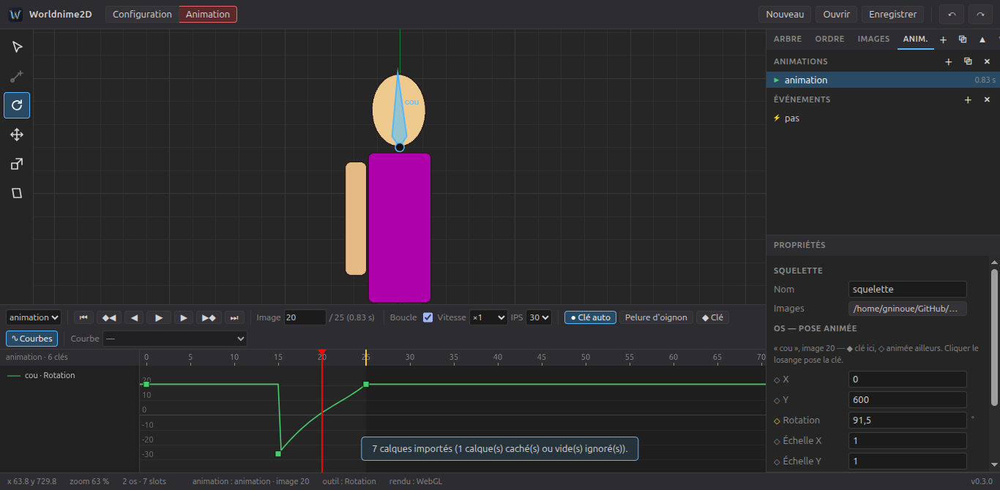

<p align="center">
  
</p>

<h1 align="center">Worldnime2D</h1>

<p align="center">
  Éditeur d'animation 2D par squelette, libre et open source, pour Windows et Linux.
</p>

---

## Le projet

Worldnime2D est un éditeur d'animation 2D par os (animation « squelettale »), dans l'esprit de logiciels comme Spine.
On découpe un personnage en morceaux, on construit un squelette, puis on anime les os.

L'objectif à terme est d'offrir le même ensemble de fonctionnalités qu'un éditeur professionnel de ce type :
os, slots, maillages déformables, poids, contraintes IK, skins, timeline, courbes, export pour les moteurs de jeu.
C'est un gros chantier, alors j'avance par étapes. La liste complète est dans la **[feuille de route](ROADMAP.md)**.

Je construis ce projet pour apprendre (Electron, rendu WebGL avec PixiJS, mathématiques des transformations 2D)
et parce que j'en ai besoin pour mes propres jeux.

> **État actuel : v0.4 — courbes.** On construit un squelette, on y attache les images d'un personnage
> (ou on importe directement un fichier Krita / Photoshop), puis on l'anime avec une timeline à clés
> et un éditeur de courbes. Les maillages et les contraintes arrivent dans les prochaines versions.



## Ce que fait Worldnime2D aujourd'hui

### Courbes (v0.4)

- Interpolation par clé : linéaire, palier ou courbe de Bézier
- **Éditeur de courbes** (bouton « Courbes » ou touche G) : les valeurs animées tracées dans le temps,
  poignées de Bézier à tirer, valeur d'une clé réglable à la souris (Alt : la déplacer dans le temps)
- Préréglages : accélération, ralentissement, les deux, dépassement, anticipation

### Animation (v0.3)

- Mode **Configuration** (Ctrl+1) pour construire, mode **Animation** (Ctrl+2) pour animer
- Plusieurs animations par projet (onglet **Anim.** : créer, dupliquer, renommer, supprimer)
- **Timeline** (dopesheet) : clés de rotation, position, échelle, cisaillement, pièce jointe, couleur,
  couleur sombre, ordre d'affichage et événements ; une ligne par os et par slot, dépliable par type
- **Clé automatique** : on transforme un os à la souris, la clé est posée ; losanges ◆ / ◇ dans les propriétés
- Clés relatives à la pose de base (comme Spine) : retoucher la pose de base se répercute sur les animations
- Sélection des clés (clic, Maj, rectangle), déplacement, **étirement dans le temps** (Alt), copier / coller, suppression
- Courbes par clé : linéaire, palier, et courbes douces prédéfinies
- Lecture, boucle, vitesse, images par seconde, **plage de lecture** (Maj + glisser dans la règle)
- **Pelure d'oignon** (images voisines en transparence)
- **Événements** (entier, décimal, texte, son) : affichés et joués pendant la lecture
- En mode Animation, cliquer sur une image sélectionne son os : on anime un membre en cliquant dessus

### Images et slots (v0.2)

- Import d'un fichier à calques **ORA** (Krita, GIMP, MyPaint) ou **PSD** (Photoshop) : un PNG recadré par calque,
  un slot par calque, ordre d'affichage et positions repris du document. Réimporter met les images à jour.
- Dossier d'images surveillé : une image retouchée dans Krita se met à jour toute seule dans l'éditeur
- Onglet **Images** : glisser une image sur la vue ou sur un os pour l'attacher
- Slots avec plusieurs pièces jointes (on choisit celle qui est visible), changement d'os sans que l'image bouge
- Clic sur une image pour la sélectionner (au pixel près), outils Rotation / Déplacement / Échelle sur les images
- Onglet **Ordre** : ordre d'affichage par glisser-déposer
- Couleur et opacité des slots et des images, **teinte sombre** (« tint black »), modes de fusion normal, additif, produit, écran
- Image de référence en fond, avec opacité, échelle et position
- Chemins enregistrés relativement au projet : on peut déplacer le dossier du projet avec ses images

### Squelette (v0.1)

- Création d'os à la souris (cliquer-glisser), os de longueur nulle, hiérarchie parent / enfants
- Outils Sélection, Rotation, Déplacement, Échelle, Cisaillement (Maj pour aimanter à 15°)
- Arbre des os : renommer (double-clic), changer de parent par glisser-déposer, réordonner, dupliquer, supprimer
- Panneau de propriétés : position, rotation, longueur, échelle, cisaillement, mode d'héritage, couleur
- Cinq modes d'héritage de la transformation du parent (normal, position seulement, sans rotation, sans échelle…)
- Annuler / rétablir (200 étapes), Échap pour annuler un geste en cours
- Vue avec grille, zoom à la molette, déplacement (clic droit, clic molette ou Espace)
- Projets enregistrés au format `.wn2d` (JSON lisible, [décrit ici](docs/FORMAT.md)), ouverture par double-clic

## Installation

Les installeurs sont sur la page **[Releases](https://github.com/gninoue-dev/Worldnime2D/releases)**.

| Système | Fichier | Installation |
|---|---|---|
| Windows 10 / 11 | `Worldnime2D-Setup-x.y.z.exe` | Double-clic, puis suivre l'assistant. Windows peut afficher « Windows a protégé votre ordinateur » car l'installeur n'est pas signé : cliquer sur *Informations complémentaires* puis *Exécuter quand même*. |
| Ubuntu / Debian | `worldnime2d_x.y.z_amd64.deb` | `sudo apt install ./worldnime2d_x.y.z_amd64.deb` |
| Autres Linux | `Worldnime2D-x.y.z.AppImage` | `chmod +x Worldnime2D-*.AppImage` puis double-clic |

## Développer

Il faut [Node.js](https://nodejs.org) 20 ou plus récent.

```bash
git clone https://github.com/gninoue-dev/Worldnime2D.git
cd Worldnime2D
npm install
npm start            # lance l'éditeur
npm test             # tests du modèle (squelette, maths, format de fichier)
npm run selftest     # test automatique de l'interface (pilote la souris, importe ORA et PSD, vérifie les pixels)
npm run dist:linux   # construit l'AppImage et le .deb dans release/
npm run dist:win     # construit l'installeur Windows (sous Windows, ou via GitHub Actions)
```

Sous Linux, `npm start` lance Electron avec `--no-sandbox`, car le bac à sable de Chromium
demande des droits root sur la version de développement. Les versions installées gardent le bac à sable.

À chaque étiquette `v*` poussée sur GitHub, [GitHub Actions](.github/workflows/build.yml) lance les tests,
construit les installeurs Windows et Linux et les publie dans une Release.

### Organisation du code

```
src/main/             processus principal d'Electron (fenêtre, menus, fichiers)
src/renderer/js/
  model/              squelette, os, slots, pièces jointes, skins, format .wn2d (sans dépendance, testé)
  editor/             état de l'éditeur, sélection, outils, annuler/rétablir
  view/               zone de dessin PixiJS, shader « deux couleurs », gestion de la souris
  ui/                 panneaux Arbre, Ordre, Images, Animations, Propriétés et timeline
  io/                 bibliothèque d'images, import ORA / PSD
tests/                tests du modèle et de l'éditeur (node --test)
tests/fixtures/       petits fichiers ORA et PSD de test (et les scripts qui les génèrent)
```

## Remarque

Worldnime2D est un projet indépendant. Il n'est pas affilié à Esoteric Software, l'éditeur de Spine,
et ne contient aucun code de Spine. Le format `.wn2d` est un format propre au projet.

## Licence

[MIT](LICENSE) — libre d'utilisation, de modification et de redistribution.
